# Nagi 凪

**a calm zen-garden theme for [copyparty](https://github.com/9001/copyparty)**

your folders turn into pebbles, free space is a little koi pond, and the root gets raked sand. made it for my home server and now i just sit there watching the fish lol 🐟

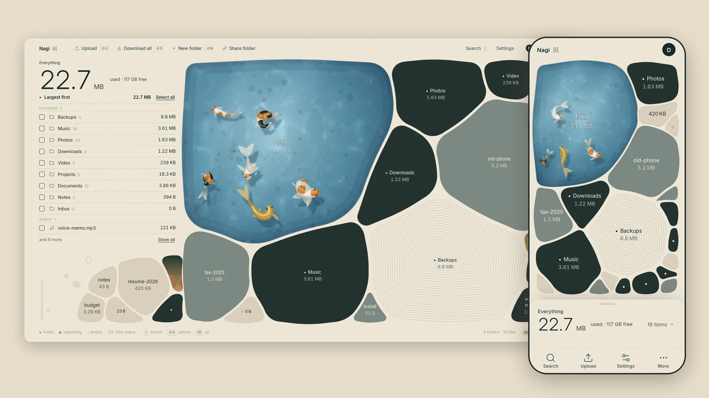

Nagi is a skin for copyparty, a portable file server in one Python file. It only adds CSS and JS, so copyparty still does all the real work (uploads, accounts, search, shares). You can flip back to the classic copyparty UI from Settings at any time.

- 🌐 **try it without a server:** open [`demo/index.html`](demo/index.html) in a browser (fictional files, same app code)

## Features

- **Pebble garden**: every file and folder is a stone sized by how much space it takes. Folders are dark stones, files are light, empty ones are rings
- **Koi pond = free space**: the disk's free space is a pond with koi swimming in it. It drops to 30 fps when you're idle and pauses when it's off screen
- **Raked sand at the root**: the biggest stone at the top level gets sand rings around it
- **Checklist + list view**: grouped by type (folders, video, audio, images, docs, code, archives), with folder icons. Press `G` to switch between garden and list
- **Players**: a music player with a queue (artist/title come from tags), plus video, image lightbox and text/markdown viewers. Each has a small download button next to the title
- **Upload**: drag and drop anywhere or use the upload sheet. A quiet "3 files uploaded" note shows instead of a big toast. Uses copyparty's up2k, so uploads resume and dedup
- **Safe bulk actions**: "Download all" asks first. Delete, rename, move, new folder and share links work the copyparty way
- **Paper and dusk themes** (light / dark) and a calmer copyparty login page
- **iPhone / PWA**: add it to your home screen and it opens like an app. Bottom tab bar with big tap targets, account menu in More, safe-area aware, no pull-to-refresh or zoom on inputs
- **Accessible**: keyboard shortcuts, focus traps in dialogs, `prefers-reduced-motion` respected
- **Smart search**: in Settings, pick **Smart (EmbeddingGemma 2)** or copyparty’s **Default** filename index. The search drawer looks the same either way. If the Smart sidecar is down, it falls back to Default on its own. The extension is one Python file; see [`ext/`](ext/README.md)

| | |
|---|---|
| 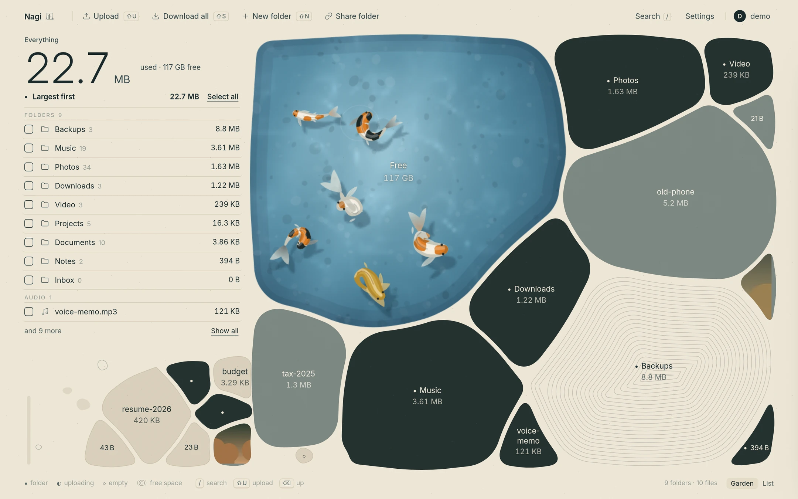 | 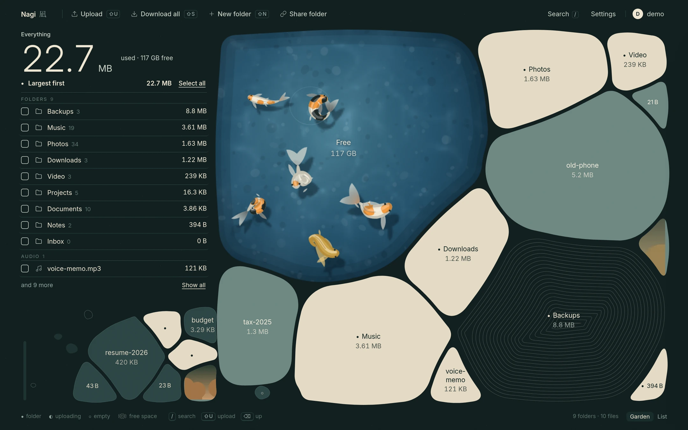 |
| 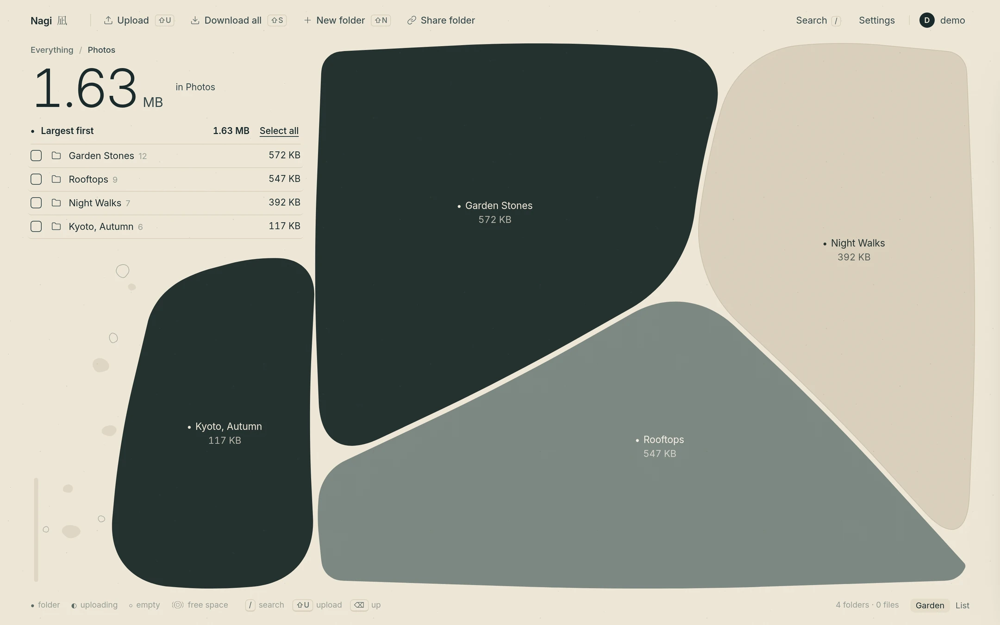 | 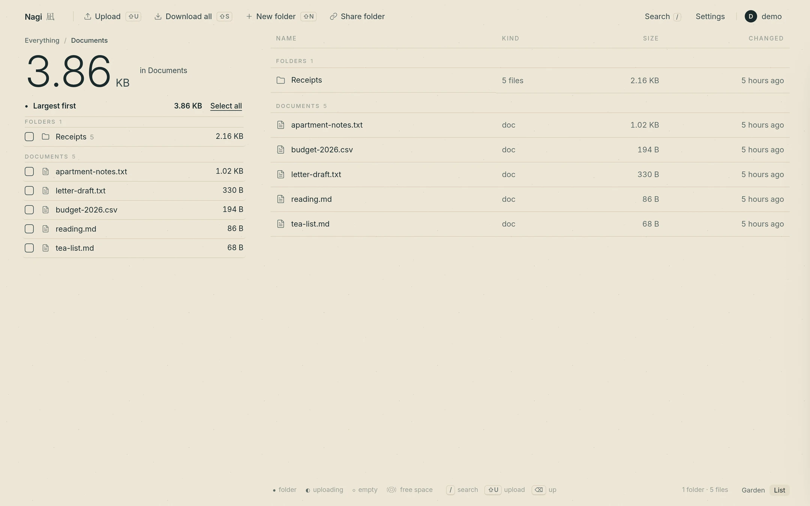 |
| 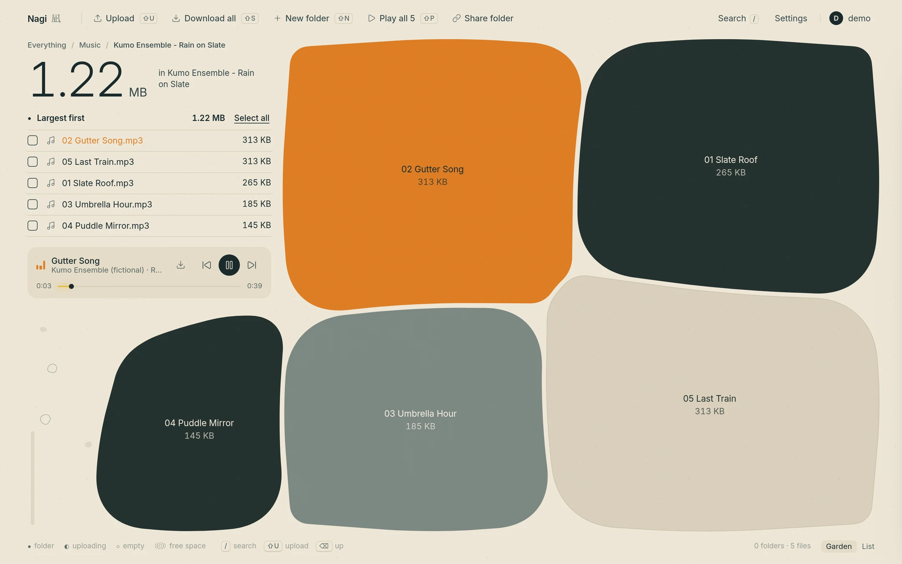 | 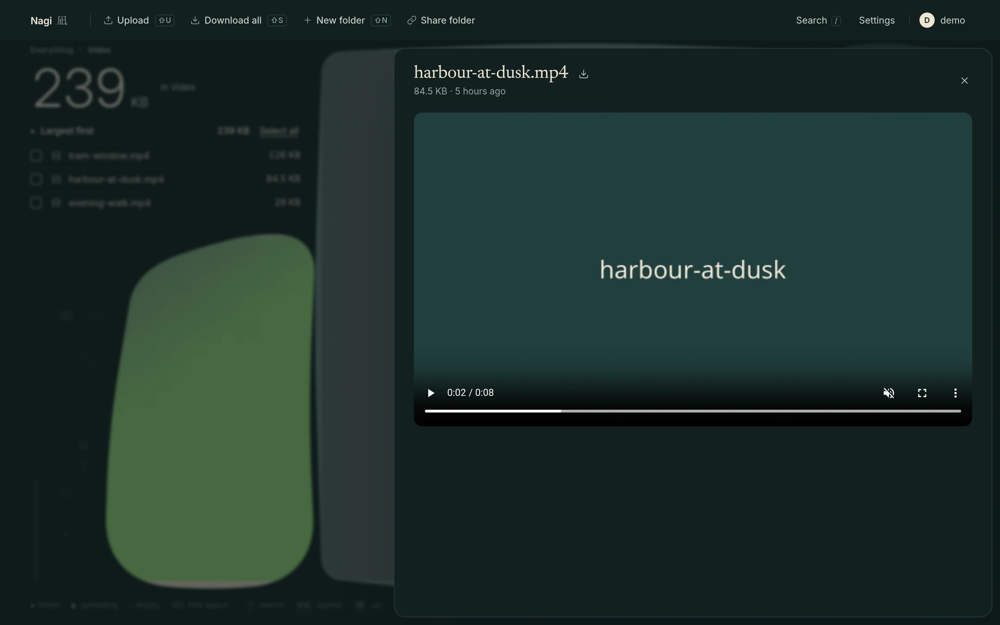 |

<p align="center">
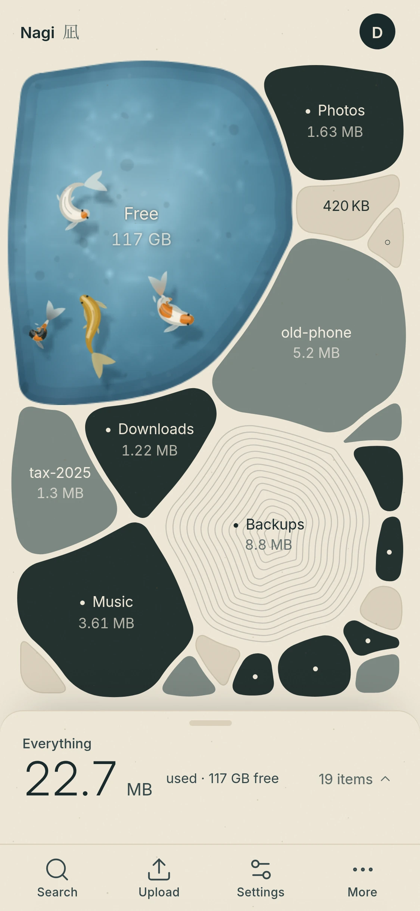 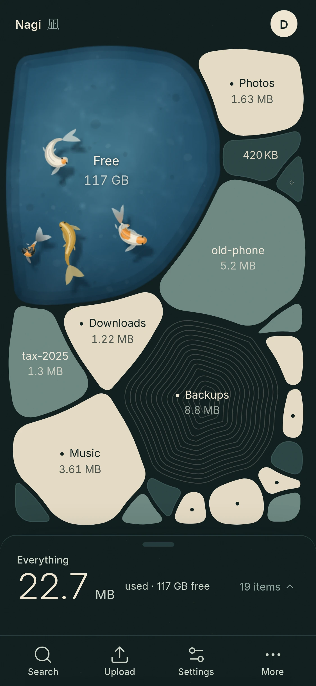 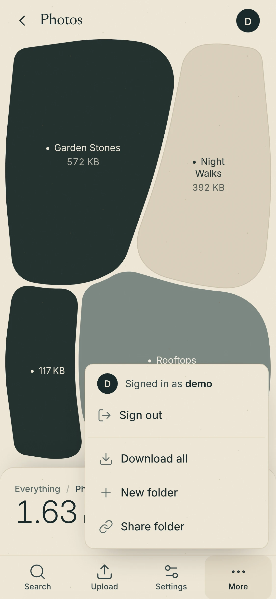 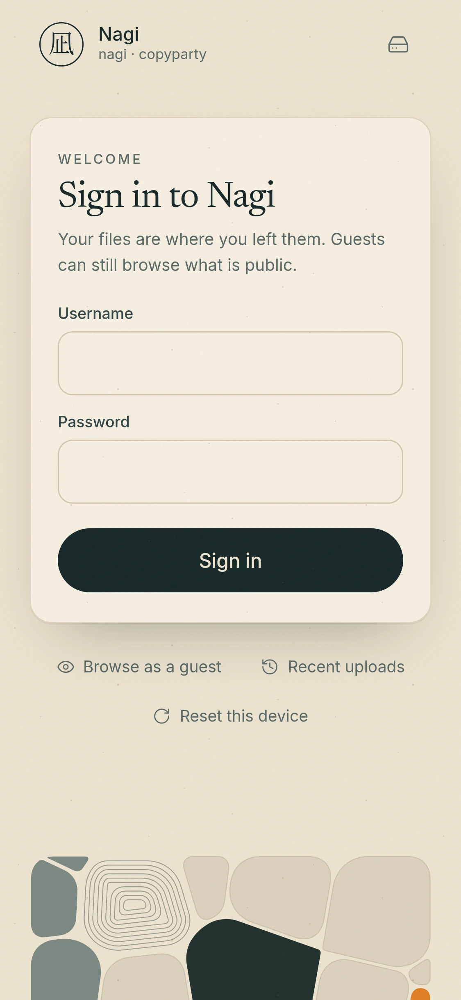
</p>

### Keyboard shortcuts

| key | does |
|---|---|
| `/` | search |
| `G` | garden ↔ list view |
| `Backspace` or `Alt+↑` | up one folder |
| `Shift+U` | upload |
| `Shift+N` | new folder |
| `Shift+S` | download (the selection, the whole folder, or the open video/image) |
| `Shift+P` | play all / play the selection |
| `Space` | play / pause music |
| `←` `→` | previous / next image in the lightbox |
| `Ctrl/⌘+A` | select everything here |
| `Esc` | close / clear the selection |
| `Enter` / `Esc` | confirm / cancel in dialogs |

## Install

You need Python 3 and copyparty (tested with copyparty 1.20.x).

```sh
pip install copyparty            # or: pipx install copyparty
git clone https://github.com/Chronoz/nagi
```

The theme is just the [`theme/`](theme) folder. Mount it read-only at `/.nagi` and point copyparty's theme flags at it:

```sh
copyparty -p 3979 -i 127.0.0.1 \
  -a alice:CHANGE-ME --usernames \
  -v /path/to/your/files:/:r:rwmda,alice \
  -v ./nagi/theme:/.nagi:r \
  --themes 12 --theme 11 --u2j 4 \
  --css-browser '/.nagi/nagi.css?nagi=5c15f771b5&cache=31536000' \
  --js-browser  '/.nagi/nagi.js?nagi=ed23f390b2&cache=31536000' \
  --js-other    '/.nagi/nagi-pages.js?nagi=e8ea5630fb&cache=31536000' \
  --html-head-s '<link rel="stylesheet" href="/.nagi/nagi-pages.css?nagi=0c6fcba267&cache=31536000"><link rel="manifest" href="/.nagi/manifest.json?nagi=b8ef2fba1e&cache=31536000"><link rel="apple-touch-icon" href="/.nagi/icon-180.png?nagi=88d99dbc9b&cache=31536000"><meta name="apple-mobile-web-app-capable" content="yes"><meta name="mobile-web-app-capable" content="yes"><meta name="apple-mobile-web-app-title" content="Nagi"><meta name="apple-mobile-web-app-status-bar-style" content="black-translucent">' \
  --favico "凪 17282B EEE5D1" --no-robots
```

Then open <http://127.0.0.1:3979/>.

What each flag does:

| flag | why |
|---|---|
| `-v ./nagi/theme:/.nagi:r` | serves the theme files at `/.nagi/`, read-only for everyone |
| `--css-browser`, `--js-browser` | load Nagi into copyparty's file browser. Quote the URLs: an unquoted `&` is a bash background job. The `?nagi=HASH&cache=31536000` query lets the browser cache the file for a year; `src/build.py` updates the hash when you rebuild |
| `--js-other` + `--html-head-s` | load the calm login/control-panel pages, the PWA manifest and the iPhone home-screen icon on every other page |
| `--u2j 4` | four parallel up2k upload chunks (good over Tailscale / a phone). Server default is 2 |
| `--themes 12 --theme 11` | gives Nagi its own copyparty theme slot so copyparty's own colours don't leak in |
| `--usernames` | log in with username + password (instead of password only) |
| `-v …:/:r:rwmda,alice` | guests can browse & download, `alice` can upload, move, delete and admin |

### Shortcut: the run script

```sh
NAGI_USER=alice NAGI_PASS='a-long-password' ./examples/run-local.sh /path/to/your/files
```

[`examples/run-local.sh`](examples/run-local.sh) does all of the above. It reads the account from env vars (nothing gets saved), binds to `127.0.0.1`, and takes `PORT=…` and `BIND=…` if you want something else.

### Config-file form

Prefer a config file? See [`examples/copyparty.conf`](examples/copyparty.conf), then run `copyparty -c copyparty.conf`. The Nagi part looks like this:

```yaml
[global]
  themes: 12
  theme: 11
  u2j: 4
  css-browser: /.nagi/nagi.css?nagi=5c15f771b5&cache=31536000
  js-browser: /.nagi/nagi.js?nagi=ed23f390b2&cache=31536000
  js-other: /.nagi/nagi-pages.js?nagi=e8ea5630fb&cache=31536000
  html-head-s: <link rel="stylesheet" href="/.nagi/nagi-pages.css?nagi=0c6fcba267&cache=31536000"><link rel="manifest" href="/.nagi/manifest.json?nagi=b8ef2fba1e&cache=31536000"> …

[/.nagi]
  /path/to/nagi/theme
  accs:
    r: *
```

## Remote access

Works great over [Tailscale](https://tailscale.com): just bind copyparty to `127.0.0.1` plus your tailnet IP (`-i 127.0.0.1,100.x.y.z`) instead of `0.0.0.0`, and open it from your phone anywhere. `--u2j 4` (already in the examples) runs four parallel up2k chunks, which is a good default for an iPhone over Tailscale. Leave turbo mode off; hashing already runs in a web worker on Safari.

## iPhone: add to home screen

1. Open your Nagi URL in **Safari**.
2. Tap **Share** → **Add to Home Screen** → **Add**.
3. Open it from the home screen. It runs full screen with no address bar, and you stay signed in.

On mobile, Search / Upload / Settings / More live in the bottom bar. **More → Sign in** takes you to the sign-in page and brings you back to the same folder afterwards. Android/Chrome: menu → *Install app*.


## Smart search

Nagi can use two engines; you pick one in **Settings → Search engine**:

- **Smart (EmbeddingGemma 2)** — meaning and keywords, including text inside documents. Needs the [`ext/nagi-search.py`](ext/nagi-search.py) sidecar (one stdlib Python file, next to your copyparty install, never inside `site-packages`).
- **Default** — copyparty’s own `/?srch` filename index. Enable it with `e2d` + `e2ds` and `no-hash: .*`, and keep `--hist` / `--dbpath` outside any cloud-synced folder so online-only files are never downloaded.

If Smart is unavailable, the drawer falls back to Default and shows a short note. Search always goes through copyparty with the user’s cookie; guests only see volumes they can read.

Install and flags: [`ext/README.md`](ext/README.md). The `--on404` volflag uses a colon: `on404: /path/to/ext/nagi-search.py`. Bind the sidecar to `127.0.0.1` only.

## Tips

- `-e2dsa` builds copyparty's file index (search, dedup, faster listings). Skip it on huge or cloud-synced folders (Dropbox, iCloud…), because it reads every file once.
- `-e2ts` reads media tags so the music player shows artist & title.
- Keep the theme mount read-only (`:r`). The theme folder is served to everyone, so don't put secrets or scripts in it.
- After a theme update, just reload the page (the `?nagi=` hash is a new URL, so the old cache is skipped). If you added it to the iPhone home screen, swipe the app away and open it again.
- Classic copyparty UI: **Settings → Classic copyparty**. Switch back from the 凪 button.

## Build from source

The `theme/` files are built from `src/`:

```sh
python3 src/build.py      # → theme/nagi*.{css,js} and demo/
```

No npm, no bundler. `src/vendor/` has the generated icon sheet (Lucide), the font faces and the shared page styles.

## Credits & thanks 🙏

- **[copyparty](https://github.com/9001/copyparty)** by **ed (9001)**: the file server that does all the heavy lifting. Nagi is just a coat of paint on top. Go star it.
- **Kanso** by **Botiverse** ([kanso.botiverse.build](https://kanso.botiverse.build/), [@botiverse](https://x.com/botiverse)): the zen-garden disk-space app whose pebble map inspired the whole look. Thank you!!
- **Mia-lab** (**Mia**, [@MiaAI_lab](https://x.com/MiaAI_lab), [github.com/MiaAI-Lab](https://github.com/MiaAI-Lab)): the koi pond is adapted from her "Koi Pond, Noon" study in [MiaAI-Lab/Claude-Fable-5.2-HTML-Files](https://github.com/MiaAI-Lab/Claude-Fable-5.2-HTML-Files) ([live](https://miaai-lab.github.io/Claude-Fable-5.2-HTML-Files/009-koi-pond-noon.html)). Used with thanks. That code came with no licence, so its author keeps all rights to those portions (see the note below and the header of [`src/koi.js`](src/koi.js)).
- Icons: [Lucide](https://lucide.dev) (ISC). Fonts: [Inter](https://github.com/rsms/inter), [Newsreader](https://github.com/productiontype/Newsreader), [IBM Plex Mono](https://github.com/IBM/plex) (SIL OFL 1.1).

Full list in [THIRD_PARTY_NOTICES.md](THIRD_PARTY_NOTICES.md).

## License

[MIT](LICENSE) for Nagi's own code.

**Note on the koi pond:** `src/koi.js` (and the koi part of the built `theme/nagi.js`) is adapted from Mia-lab's koi pond, linked above. The original was published without a licence notice, so the MIT licence does **not** cover those adapted portions, and their original author keeps all rights to them. copyparty isn't included here, only linked. Fonts and icons keep their own licences.
